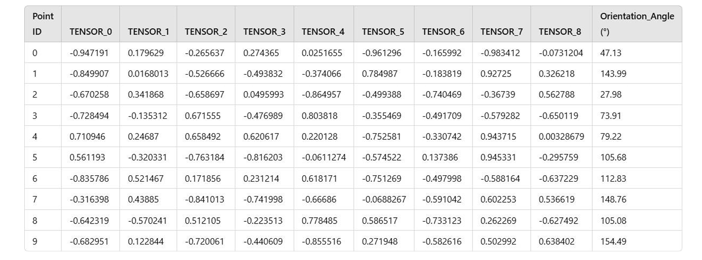
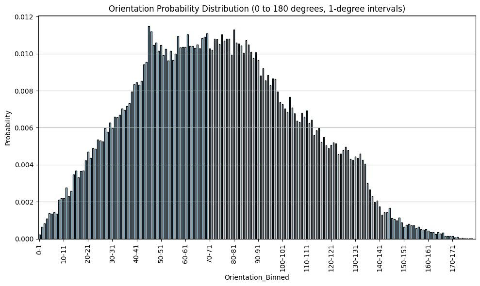
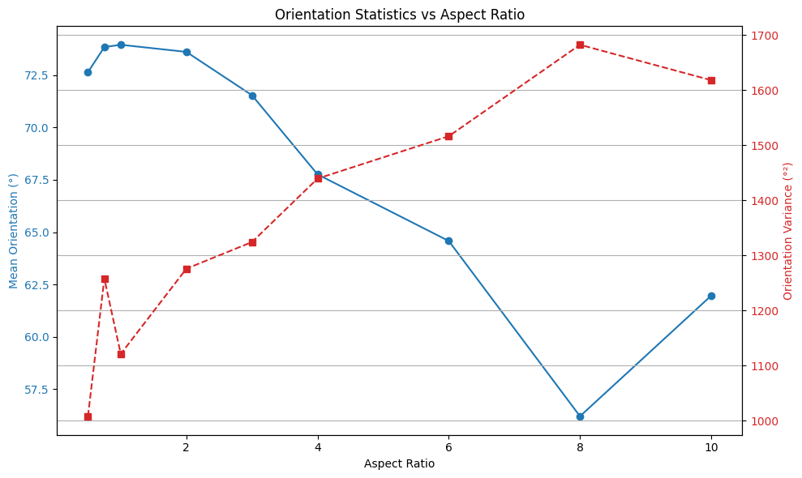

# Coupling DEM and Machine Learning for Granular Systems

**Bachelor's thesis project (Chemical Engineering, IIT Roorkee, 2024–25).** I used Discrete Element Method (DEM) simulations to study how the shape of elongated particles changes their alignment in a vibrated bed, and trained a Random Forest to predict a particle's orientation from its position and aspect ratio.

## 1. At a glance
| | |
|---|---|
| **Question** | How does particle aspect ratio shape the orientation distribution in a vibrated granular bed, and how much of a particle's orientation can be predicted from where it is and how elongated it is? |
| **Particles** | Elliptical cylinders, aspect ratios from 0.5 to 10, simulated at an initial, a mid and a final stage |
| **Data** | About 3.1 million particle rows from DEM runs (position, aspect ratio, orientation angle, 0–180°). Not included here because of size |
| **Methods** | DEM simulation, orientation from rotation-matrix data, probability distribution curves, an anisotropy index, Random Forest regression |
| **Stack** | Python, pandas, scikit-learn, matplotlib |
| **Supervisor** | Prof. Anshu Anand, Department of Chemical Engineering, IIT Roorkee |
| **Report** | [`docs/Bachelor's_Thesis_Report_Kunal_Mishra.pdf`](docs/Bachelor's_Thesis_Report_Kunal_Mishra.pdf) |


## TL;DR
 
- Ran DEM simulations of elliptical cylinders under vibration across **aspect ratios (AR) 0.5 to 10**, and extracted per-particle orientation from the rotation-tensor output.
- Characterised orientation with **probability distribution curves**, an **orientation distribution tensor**, and an **anisotropy index** (λmax − λmin), resolved along the bed height (z).
- Observed that the orientation distribution changes from a single broad peak (AR ≈ 1) to a **bimodal** shape at high AR (≥ 6, clearest at AR = 10).
- Trained a **Random Forest** on ~3.08 M particle records to predict orientation from (x, y, z, AR): **R² = 0.69** (standard), and **83% of predictions within ±35%** of the true angle.

## 2. Motivation
 

Granular systems, consisting of discrete particles, are widely used in various engineering and industrial processes.Particle orientation controls packing density, flow resistance, mixing and heat/mass transfer in granular beds, and matters for filtration, compaction, reactors and crystallisation-like ordering. Similarly, the aspect ratio directly affects its ability to rotate, stack, and form stable configurations within the system. Most prior work on orientation (e.g. Marek, Niegodajew and co-authors) addresses cylinders in static packed beds. Elliptical cylinders under vibration are less studied. This project asks:
 
1. How does aspect ratio change the orientation distribution of particles in a vibrated bed?
2. How does ordering (anisotropy) vary with height in the bed?
3. Can a cheap ML model recover local orientation from position and shape, avoiding rerunning expensive DEM?

## 3. Methodology
 
###  DEM simulation
- Elliptical cylindrical particles in a vibrating bed, sampled at three stages: **initial, mid-simulation, steady state**.
- Simulations repeated for AR ∈ {0.5, 0.75, 1, 2, 3, 4, 6, 8, 10}.
- Per-particle output: position (x, y, z) and a 3×3 rotation tensor (`TENSOR_0` … `TENSOR_8`).
- Governing equations (translation and rotation per particle):
  `m_i dV_i/dt = Σ_j (F^n_ij + F^t_ij) + F^l_ij + m_i g`,  `I_i dω_i/dt = Σ_j T_ij`

###  Orientation extraction
A Python script converts each particle's rotation tensor into an orientation angle (0–180°) relative to the reference axis, for each stage. Results are tabulated per particle (Excel/CSV) for statistics and plotting.
 
           A glimpse of how particle orientation data obtained from DEM simulation and Analysis looks
 
###  Distribution analysis
- Frequency histograms of orientation at each stage.
- 1° binned probability distributions for each AR.
- Mean and variance of orientation as a function of AR.

###  Anisotropy analysis
- A second-order **orientation distribution tensor** is built from particle orientations.
- **Anisotropy index** = λmax − λmin of that tensor (0 is isotropic; higher means more aligned).
- Computed in bins along z to give anisotropy-vs-height profiles for each AR.


## 4. What I found

**Simulation study (the main result of the thesis).**
- Particles near AR ≈ 1 show a single dominant orientation peak (roughly 70–85°). As the aspect ratio rises above about 3, a second peak appears, and elongated particles (AR 4–10) have a more spread-out, less uniform orientation distribution.
- Mean orientation is roughly flat (~73°) up to AR ≈ 2.5, then falls to ~56° at AR = 8 while variance rises to ~1700 deg². AR = 10 shows a partial reversal, which can be attributed to packing constraints or saturation.
- An anisotropy index (the difference between the largest and smallest eigenvalues of the orientation distribution) rises with aspect ratio and changes with height in the bed, with boundary effects visible near the bottom and the top.

| | |
|---|---|
|  |  |
| Orientation probability distribution (see report §4.2 for the stage and aspect ratio) | Mean orientation and orientation variance against aspect ratio |

**Machine learning part.** A Random Forest (50 trees) predicts orientation from `(x, y, z, aspect ratio)`.

| Metric on a random 80/20 split of 3,082,565 rows | Value |
|---|---|
| R² | **0.69** |
| Share of predictions within ±35% of the true angle | **0.83** |

The tolerance metric is a custom, forgiving accuracy measure, not an R² score. It is reported because small angular errors are physically acceptable in semi-ordered beds. The standard R² is the stricter number and is reported alongside it.

Figures (histograms, PDFs, anisotropy profiles, 3D scatter) are in the full report: report/BTP_Report.pdf

## 5. Limitations (what I would do differently now)

- **Random split.** Particles from the same simulation share a stage, a shape and a spatial layout, so a random split lets the model see near-copies of its test particles. The 0.69 is probably optimistic.
- **Interpretation is qualitative.** The "critical AR" for bimodality is read off plots and has not been located with a quantitative order parameter or finite-size analysis.
- **Baselines missing.** No comparison against simple baselines (e.g., predicting the per-AR mean, k-NN, gradient boosting) or tuned hyperparameters.
- **Single simulation setup per AR.** No replicate runs or varied vibration parameters, so run-to-run variability and uncertainty bounds are not quantified.
- **Importances.** Impurity-based feature importances can favour continuous variables. A permutation importance on held-out files would be a better check.

## 6. Ideas for continuing or Future Work

- Predict `(sin 2θ, cos 2θ)` instead of the raw angle so the wrap-around is respected, and predict the whole orientation distribution rather than single angles.
- Evaluate on held-out aspect ratios (can the model generalise to a shape it has not seen?) and held-out stages (e.g., train on AR ≤ 6, test on AR = 8 and 10).
- Add contact and neighbour features (local density, number of contacts) instead of position alone.

## Repository layout

```
.
├── README.md
├── requirements.txt
├── notebooks/
│   └── BTP_Orientation_Prediction.ipynb   
├── figures/                                # selected figures from the report
├── docs/
│   └── BTP_Report_...pdf                   # full thesis report
└── data/                                   
```

## Running it

```bash
pip install -r requirements.txt
# put the particle CSV files in data/  (columns: Points:0, Points:1, Points:2, aspect_ratio, Orientation)
jupyter notebook notebooks/BTP_Orientation_Prediction.ipynb
```

For a quick test on a fraction of the rows, set `BTP_SAMPLE_FRAC=0.1`. To read the data from another folder, set `BTP_DATA_DIR`.

## Contact

**Kunal Mishra**, IIT Roorkee (Chemical Engineering) · [LinkedIn](https://www.linkedin.com/in/kunal-mishra-0b117a228/) · [Portfolio](https://kunal-mishra.vercel.app/)
